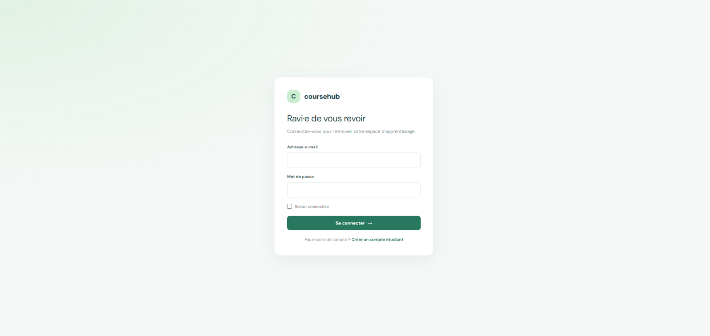
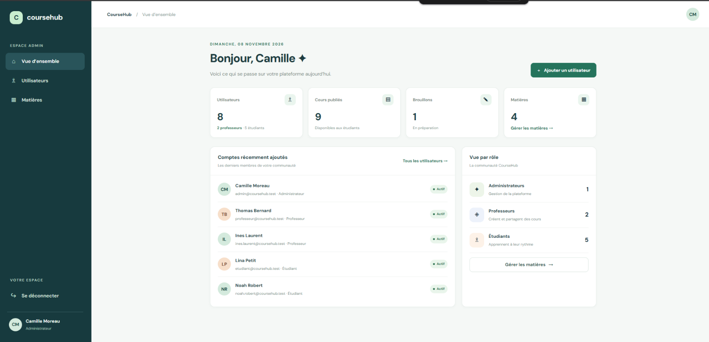
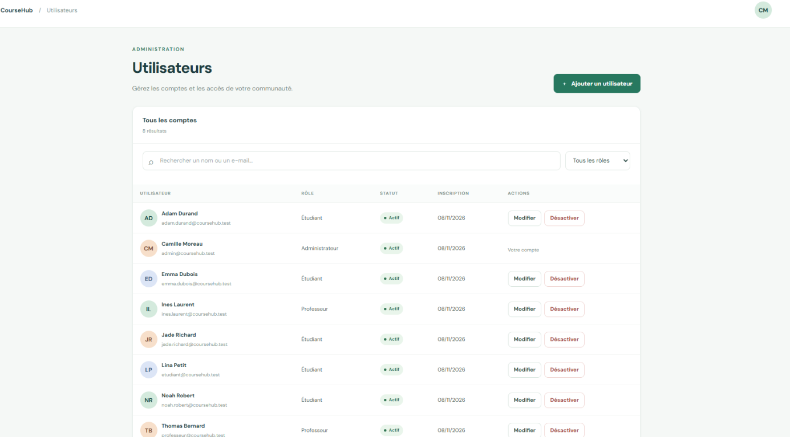
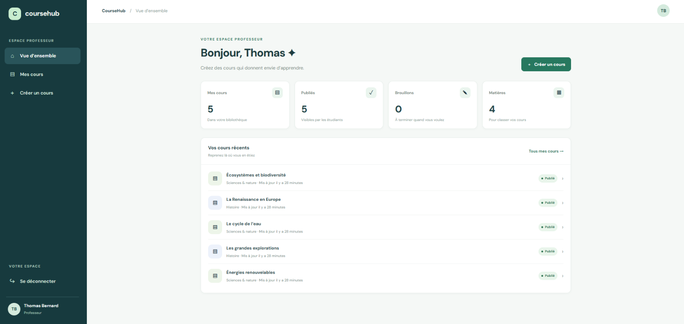
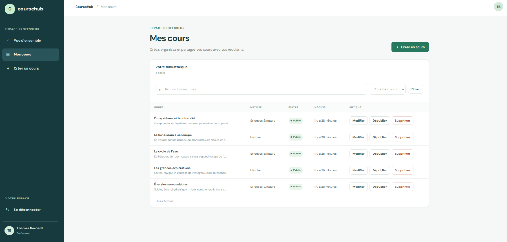
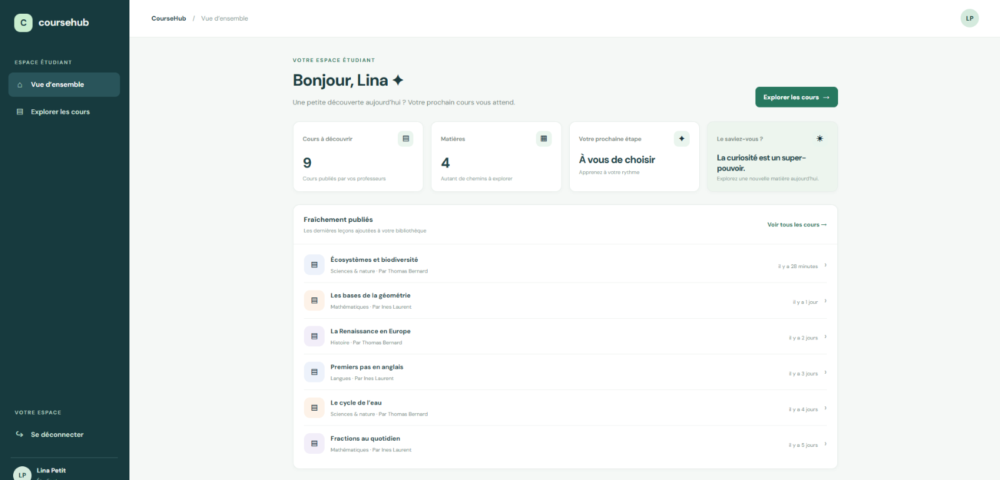
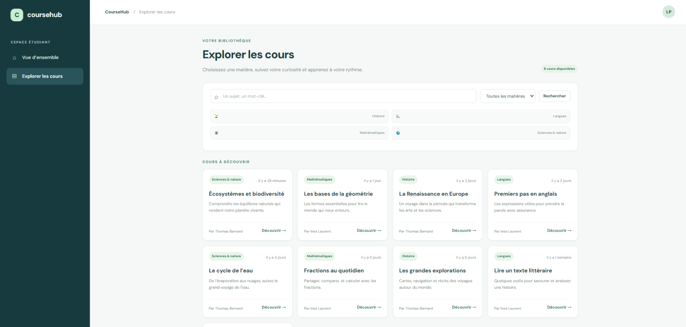

# CourseHub

An educational course platform focused on clear, responsive experiences for administrators, teachers, and students.

## About this project

CourseHub is a recreation of the features of an educational web application I worked on during an internship: course publishing and browsing, with administrator, teacher and student roles. It contains no code, template or data from the original project. The back-end here is a simplified version built for this demo, and all accounts and content are fictional.

## Features

- **Administrator:** manage user accounts, roles, active status, and subjects; review platform statistics.
- **Teacher:** create and manage courses, save drafts, publish or unpublish lessons, and attach PDF files.
- **Student:** browse and search published courses by subject, read course content, and download attachments.
- **Shared experience:** role-based navigation and access, sign-in and student registration, validated forms, dynamic search and filters, paginated lists, and responsive layouts.

## Screenshots

### Sign-in



The entry point for all roles, with a focused layout that keeps authentication simple and makes student registration easy to find.

### Administrator dashboard



Summarizes users, published courses, drafts, and subjects so administrators can quickly understand the state of the platform.

### User management



Shows how administrators search and filter accounts, review roles and statuses, and manage access from one screen.

### Teacher dashboard



Gives teachers a quick view of their published courses and drafts, with a direct route to creating a lesson.

### Course management



Displays a teacher’s course library, including subjects, publication status, search, and the actions used to edit, publish, or remove a course.

### Student dashboard



Highlights recently published lessons to help students continue exploring from their role-specific home page.

### Student course catalog



Shows the discovery experience: students can search available courses, filter by subject, and scan course cards before opening a lesson.

## Tech stack

Laravel · PHP 8.2+ · MySQL · Blade · Tailwind CSS · JavaScript · Vite

## Demo accounts

All demo accounts use the password `CourseHub2026!`.

| Role | Email |
|---|---|
| Administrator | `admin@coursehub.test` |
| Teacher | `professeur@coursehub.test` |
| Student | `etudiant@coursehub.test` |

Additional seeded accounts: `ines.laurent@coursehub.test`, `noah.robert@coursehub.test`, `jade.richard@coursehub.test`, `adam.durand@coursehub.test`, and `emma.dubois@coursehub.test`.

## Getting started

**Prerequisites:** PHP 8.2+ with the Laravel extensions (`pdo_mysql`, `mbstring`, `openssl`, `fileinfo`, `tokenizer`, `xml`, `ctype`, and `curl`), Composer 2, Node.js 20+ with npm, and MySQL 8+.

From the project directory:

```powershell
composer install

# PowerShell on Windows:
Copy-Item .env.example .env

# Alternatively, in Bash (including Git Bash), macOS, or Linux:
# cp .env.example .env

php artisan key:generate

# Create a MySQL database named coursehub, then set DB_HOST, DB_PORT,
# DB_DATABASE, DB_USERNAME, and DB_PASSWORD in .env.

npm install
php artisan migrate --seed
npm run build
php artisan serve
```

Open [http://127.0.0.1:8000](http://127.0.0.1:8000). For front-end development with live reload, run `npm run dev` in a second terminal.
